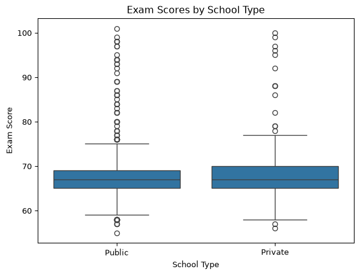
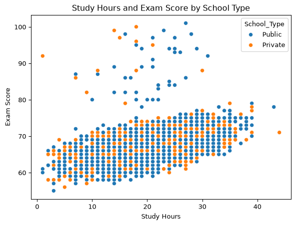
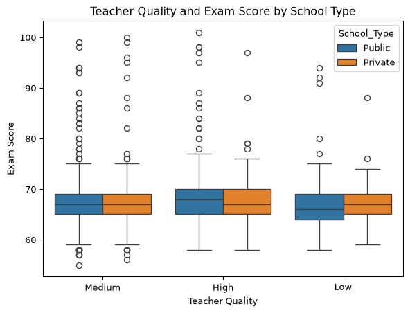
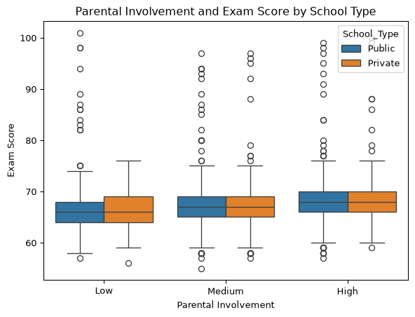
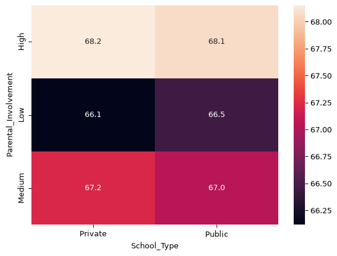

# Student Performance Project: Data Wrangling
Izabelle Losee

Preparing the Data

``` python
import pandas as pd
import seaborn as sns
import matplotlib.pyplot as plt

data = pd.read_csv("C:/Users/izlos/Downloads/StudentPerformanceFactors.csv")

data.head()
```


|  | Hours_Studied | Attendance | Parental_Involvement | Access_to_Resources | Extracurricular_Activities | Sleep_Hours | Previous_Scores | Motivation_Level | Internet_Access | Tutoring_Sessions | Family_Income | Teacher_Quality | School_Type | Peer_Influence | Physical_Activity | Learning_Disabilities | Parental_Education_Level | Distance_from_Home | Gender | Exam_Score |
|----|----|----|----|----|----|----|----|----|----|----|----|----|----|----|----|----|----|----|----|----|
| 0 | 23 | 84 | Low | High | No | 7 | 73 | Low | Yes | 0 | Low | Medium | Public | Positive | 3 | No | High School | Near | Male | 67 |
| 1 | 19 | 64 | Low | Medium | No | 8 | 59 | Low | Yes | 2 | Medium | Medium | Public | Negative | 4 | No | College | Moderate | Female | 61 |
| 2 | 24 | 98 | Medium | Medium | Yes | 7 | 91 | Medium | Yes | 2 | Medium | Medium | Public | Neutral | 4 | No | Postgraduate | Near | Male | 74 |
| 3 | 29 | 89 | Low | Medium | Yes | 8 | 98 | Medium | Yes | 1 | Medium | Medium | Public | Negative | 4 | No | High School | Moderate | Male | 71 |
| 4 | 19 | 92 | Medium | Medium | Yes | 6 | 65 | Medium | Yes | 3 | Medium | High | Public | Neutral | 4 | No | College | Near | Female | 70 |


``` python
data.drop_duplicates()

data.describe

data.groupby('School_Type').size()
```

    School_Type
    Private    2009
    Public     4598
    dtype: int64

The focus of my project is seeing how students at different schools
perform on exams. The first initial question is to see if there is a
difference between school types. Here is an initial look at the average
exam scores at public and private schools.

``` python
stats = data.groupby('School_Type').agg(
    {'Exam_Score': ['mean','median','std', 'min', 'max'], 
    'Previous_Scores': ['mean','median', 'std', 'min', 'max']}
    ).reset_index()

stats
```

<div>
<style scoped>
    .dataframe tbody tr th:only-of-type {
        vertical-align: middle;
    }
&#10;    .dataframe tbody tr th {
        vertical-align: top;
    }
&#10;    .dataframe thead tr th {
        text-align: left;
    }
</style>

<table class="dataframe" data-quarto-postprocess="true" data-border="1">
<thead>
<tr>
<th data-quarto-table-cell-role="th"></th>
<th data-quarto-table-cell-role="th">School_Type</th>
<th colspan="5" data-quarto-table-cell-role="th"
data-halign="left">Exam_Score</th>
<th colspan="5" data-quarto-table-cell-role="th"
data-halign="left">Previous_Scores</th>
</tr>
<tr>
<th data-quarto-table-cell-role="th"></th>
<th data-quarto-table-cell-role="th"></th>
<th data-quarto-table-cell-role="th">mean</th>
<th data-quarto-table-cell-role="th">median</th>
<th data-quarto-table-cell-role="th">std</th>
<th data-quarto-table-cell-role="th">min</th>
<th data-quarto-table-cell-role="th">max</th>
<th data-quarto-table-cell-role="th">mean</th>
<th data-quarto-table-cell-role="th">median</th>
<th data-quarto-table-cell-role="th">std</th>
<th data-quarto-table-cell-role="th">min</th>
<th data-quarto-table-cell-role="th">max</th>
</tr>
</thead>
<tbody>
<tr>
<td data-quarto-table-cell-role="th">0</td>
<td>Private</td>
<td>67.287705</td>
<td>67.0</td>
<td>3.848844</td>
<td>56</td>
<td>100</td>
<td>74.777501</td>
<td>75.0</td>
<td>14.366461</td>
<td>50</td>
<td>100</td>
</tr>
<tr>
<td data-quarto-table-cell-role="th">1</td>
<td>Public</td>
<td>67.212919</td>
<td>67.0</td>
<td>3.908697</td>
<td>55</td>
<td>101</td>
<td>75.198565</td>
<td>75.0</td>
<td>14.414010</td>
<td>50</td>
<td>100</td>
</tr>
</tbody>
</table>

</div>

``` python
school_type_plot = sns.boxplot(
    data= data, 
    x= 'School_Type',
    y= 'Exam_Score'
)

plt.title("Exam Scores by School Type")
plt.xlabel('School Type')
plt.ylabel('Exam Score')

plt.show()
```



The first look showed that there is not a huge difference in scores
between school types. The most current exam had only around a .08
difference, with private scores holding the higher average. While the
previous exam scores showed a .4 difference with public schools holding
the higher average score. This showed that there are other factors that
play into students performance rather than just school type. I then
wanted to go explore the relationships between the variables and exam
scores.

``` python
sns.scatterplot(
    data=data,
    x= 'Hours_Studied',
    y='Exam_Score',
    hue= 'School_Type'
)

plt.title('Study Hours and Exam Score by School Type')
plt.xlabel('Study Hours')
plt.ylabel("Exam Score")

plt.show()
```



Hours Studied and Exam Scores showed a positive relationship. The more
hours a student studied the higher their exam scores were. There were a
good amount of outliers but that makes sense with exam scores, some
students are naturally good at test taking and do not have to spend time
studying.

``` python
sns.boxplot(
    data=data,
    x= 'Teacher_Quality',
    y='Exam_Score',
    hue= 'School_Type'
)

plt.title('Teacher Quality and Exam Score by School Type')
plt.xlabel('Teacher Quality')
plt.ylabel("Exam Score")

plt.show()
```



Teacher Quality did not seem to be as strong of an indicator as Hours
Studied, although the students that went to public school and had a high
quality teacher had the highest average scores.

``` python
sns.boxplot(
    data=data,
    x= 'Parental_Involvement',
    y='Exam_Score',
    hue= 'School_Type'
)

plt.title('Parental Involvement and Exam Score by School Type')
plt.xlabel('Parental Involvement')
plt.ylabel("Exam Score")

plt.show()
```



Parental Involvement showed to be a positive relationship. The more
involvement a parent has the better the student scores on the exam. Each
group’s scores continued to increase as the parental invovlement
increased.

``` python
summary = data.groupby(
    ['School_Type', "Parental_Involvement"])['Exam_Score'].mean().reset_index()

summary
```

<div>
<style scoped>
    .dataframe tbody tr th:only-of-type {
        vertical-align: middle;
    }
&#10;    .dataframe tbody tr th {
        vertical-align: top;
    }
&#10;    .dataframe thead th {
        text-align: right;
    }
</style>

|     | School_Type | Parental_Involvement | Exam_Score |
|-----|-------------|----------------------|------------|
| 0   | Private     | High                 | 68.152801  |
| 1   | Private     | Low                  | 66.115789  |
| 2   | Private     | Medium               | 67.225962  |
| 3   | Public      | High                 | 68.065959  |
| 4   | Public      | Low                  | 66.454545  |
| 5   | Public      | Medium               | 67.040913  |

</div>

Here it is showed in a pivot table so it is simplified and easier to
interpret.

``` python
pivot = pd.pivot_table(
    data, 
    values= 'Exam_Score',
    index = 'Parental_Involvement',
    columns = "School_Type",
    aggfunc= 'mean'
)

pivot
```


| School_Type          | Private   | Public    |
|----------------------|-----------|-----------|
| Parental_Involvement |           |           |
| High                 | 68.152801 | 68.065959 |
| Low                  | 66.115789 | 66.454545 |
| Medium               | 67.225962 | 67.040913 |


Overall, each variable had a little/weak relationship with exam score.
School type alone was not enough to see a significant difference, or be
used to make predictions or decisions. Combing the variables together
however would help to create a big picture of each student.

``` python
sns.heatmap(
    pivot, 
    annot = True, 
    fmt= '.1f'
)

plt.show()
```



After doing a basic analysis and seeing how to various characteristics
compare with exam scores, I wanted to run a linear regression model to
see which was most strongly associated with exam performance and how
they would interact with each other.

``` python
import statsmodels.api as sm
import numpy as np
x= data[
    ["School_Type",
    'Hours_Studied',
    'Teacher_Quality',
    'Parental_Involvement',
    'Parental_Education_Level']
]

y= data['Exam_Score']

x= pd.get_dummies(x, drop_first=True)

x= x.astype(float)

x=sm.add_constant(x)

model= sm.OLS(y,x).fit()
model.summary()
```

|                   |                  |                     |           |
|-------------------|------------------|---------------------|-----------|
| Dep. Variable:    | Exam_Score       | R-squared:          | 0.243     |
| Model:            | OLS              | Adj. R-squared:     | 0.242     |
| Method:           | Least Squares    | F-statistic:        | 264.7     |
| Date:             | Mon, 12 Oct 2026 | Prob (F-statistic): | 0.00      |
| Time:             | 13:18:32         | Log-Likelihood:     | -17431.   |
| No. Observations: | 6607             | AIC:                | 3.488e+04 |
| Df Residuals:     | 6598             | BIC:                | 3.494e+04 |
| Df Model:         | 8                |                     |           |
| Covariance Type:  | nonrobust        |                     |           |

OLS Regression Results {.simpletable quarto-postprocess="true"}

|  |  |  |  |  |  |  |
|----|----|----|----|----|----|----|
|  | coef | std err | t | P\>\|t\| | \[0.025 | 0.975\] |
| const | 62.8234 | 0.191 | 329.096 | 0.000 | 62.449 | 63.198 |
| Hours_Studied | 0.2917 | 0.007 | 41.920 | 0.000 | 0.278 | 0.305 |
| School_Type_Public | -0.0330 | 0.091 | -0.364 | 0.716 | -0.211 | 0.145 |
| Teacher_Quality_Low | -0.8679 | 0.152 | -5.706 | 0.000 | -1.166 | -0.570 |
| Teacher_Quality_Medium | -0.5421 | 0.093 | -5.849 | 0.000 | -0.724 | -0.360 |
| Parental_Involvement_Low | -1.8180 | 0.121 | -15.041 | 0.000 | -2.055 | -1.581 |
| Parental_Involvement_Medium | -1.0294 | 0.097 | -10.600 | 0.000 | -1.220 | -0.839 |
| Parental_Education_Level_High School | -0.4535 | 0.095 | -4.758 | 0.000 | -0.640 | -0.267 |
| Parental_Education_Level_Postgraduate | 0.6589 | 0.120 | 5.505 | 0.000 | 0.424 | 0.894 |

|                |          |                   |            |
|----------------|----------|-------------------|------------|
| Omnibus:       | 4117.839 | Durbin-Watson:    | 1.962      |
| Prob(Omnibus): | 0.000    | Jarque-Bera (JB): | 105275.497 |
| Skew:          | 2.545    | Prob(JB):         | 0.00       |
| Kurtosis:      | 21.881   | Cond. No.         | 106\.      |

<br/><br/>Notes:<br/>[1] Standard Errors assume that the covariance matrix of the errors is correctly specified.

The results of the linear regression model were actually surprising. It
showed that the relationship between school type and exam score was not
significant. It also showed that students with a teacher quality of low
and medium, or parental involvement of low or medium actually hurt their
score. Meaning if they were in the low parental involvement group then
they would score about 1.8 points lower than students with a high level
of parental involvement. It was also interesting to see the education
level of parents was significant and could hurt or help a student
depending on the level. Overall, school type was not a strong indicator
as I had thought would be. There are a lot of factors that play into a
student’s performance and should be used together when trying to
understand their exam scores.
